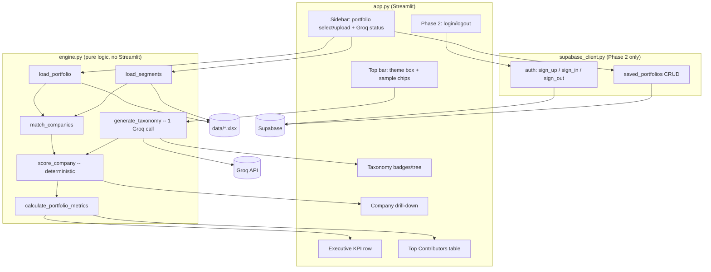
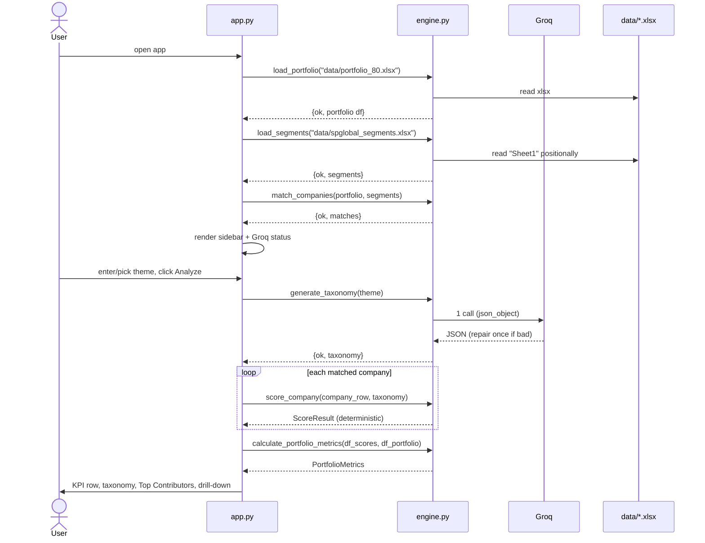

# Design Document

## Overview

The AI-Powered Thematic Portfolio Analysis prototype measures how exposed an APAC equity portfolio is to a free-form investment theme. The user types a theme; an LLM (Groq `openai/gpt-oss-120b`) decomposes it into a two-layer taxonomy; the system then scores each portfolio company **deterministically** against its reported S&P Capital IQ segment revenues and business description, and aggregates to portfolio-level exposure, benchmark exposure, and active tilt.

The central design principle, driven by Requirements 5 and 6, is a hard separation of concerns:

- **The LLM is used exactly once, only to expand the theme into a taxonomy.** It never sees portfolio weights and never produces an exposure number (Req 6.9).
- **All exposure math is deterministic and reproducible.** Identical inputs always yield identical `Company_Exposure` (Req 6.9). This makes every headline number auditable in front of an investment committee.

The system is built in two phases:

- **Phase 1 (now, local, no login):** full analysis path — load files, parse messy S&P export, match companies, generate taxonomy, score, aggregate, render. Covers Requirements 1–10.
- **Phase 2 (later):** Supabase authentication and saved-portfolio persistence. Covers Requirements 11–12. The Phase 1 analysis path must keep working with no login (Req 11.5).

This document specifies both the high-level architecture and the low-level algorithms (parsing offsets, cleaning rules, tokenization, matching thresholds, scoring tiers) in enough detail to implement directly.

### Technology Stack (fixed)

| Concern | Choice |
|---|---|
| Language | Python 3.12 |
| UI | Streamlit |
| LLM | Groq API, model `openai/gpt-oss-120b`, via `groq` client |
| Data | pandas, numpy, openpyxl |
| Fuzzy matching | `rapidfuzz` |
| Config | `python-dotenv` (`GROQ_API_KEY`) |
| Phase 2 persistence/auth | Supabase (managed Postgres + Auth) via `supabase` python client |
| Deployment target | Streamlit Community Cloud (later); runs locally now |

## Architecture

### Module / Responsibility Overview

Three source modules plus data fixtures. `engine.py` is pure logic with **no Streamlit import**, so it is unit-testable and reusable. `app.py` is the only module that touches Streamlit. A thin `supabase_client.py` isolates all Phase 2 concerns so Phase 1 never depends on it.



### Responsibilities

| Module | Responsibility | Requirements |
|---|---|---|
| `engine.py` :: `load_portfolio` | Read portfolio XLSX/CSV, validate columns, keep weights as decimal fractions | 1.2–1.7 |
| `engine.py` :: `load_segments` | Positional parse of the messy S&P export into tidy per-company segment structures | 2.1–2.12 |
| `engine.py` :: `match_companies` | Normalize + fuzzy-match portfolio rows to segment records | 3.1–3.5 |
| `engine.py` :: `generate_taxonomy` | One Groq call, strict-JSON two-layer taxonomy, retry/repair, handled errors | 5.1–5.7, 10.1–10.2 |
| `engine.py` :: `score_company` | Deterministic cleaning, weighting, alignment scoring, evidence | 4.1–4.6, 6.1–6.10 |
| `engine.py` :: `calculate_portfolio_metrics` | Portfolio/benchmark exposure, active tilt, per-company contribution | 7.1–7.4 |
| `app.py` | All UI: inputs, status, KPIs, taxonomy, contributors, drill-down, theming | 8.*, 9.*, 10.* rendering |
| `supabase_client.py` | Phase 2 auth + saved portfolio persistence with RLS | 11.*, 12.* |

### Why `engine.py` has no Streamlit dependency

Keeping scoring pure lets us (a) unit-test determinism directly (Req 6.9), (b) run the engine in a notebook or test harness, and (c) swap the UI later without touching logic. The UI calls engine functions and renders their return values or handled-error objects.

## Components and Interfaces

### Error-handling convention (shared by all engine functions)

Every engine function that can fail in an expected way returns a plain `dict`. Success and handled-failure are distinguished by an `"ok"` key rather than by raising. Only truly unexpected faults raise. This lets `app.py` render a friendly message without wrapping every call in try/except and without ever crashing (Req 10, 1.6–1.7, 2.11–2.12, 5.6–5.7).

```python
# Handled error shape (returned, never raised, for expected failures)
{
    "ok": False,
    "error_code": str,     # machine code, e.g. "MISSING_API_KEY"
    "message": str,        # human-friendly, UI-displayable
    "detail": str | None,  # optional extra context (column name, filename, raw snippet)
}

# Success shape depends on the function; always includes:
{ "ok": True, ... }
```

Canonical `error_code` values:

| error_code | Raised by | Trigger | Requirement |
|---|---|---|---|
| `MISSING_API_KEY` | generate_taxonomy | GROQ_API_KEY absent/empty | 5.6, 10.1 |
| `INVALID_API_KEY` | generate_taxonomy | Groq auth rejected | 5.6, 10.1 |
| `LLM_BAD_JSON` | generate_taxonomy | JSON invalid/non-conforming after one repair | 5.7, 10.2 |
| `LLM_UNREACHABLE` | generate_taxonomy | network/timeout | 10.2 |
| `FILE_NOT_FOUND` | load_portfolio / load_segments | file missing from `data/` | 1.7, 10.3 |
| `MISSING_COLUMN` | load_portfolio / load_segments | required column absent | 1.6, 2.12 |
| `MISSING_SHEET` | load_segments | no "Sheet1" | 2.11 |

Non-fatal per-company conditions (no segment match, no positive revenue, excluded segment) are **not** errors — they are flags carried inside the normal success result so the analysis continues for other companies (Req 3.4, 4.6, 6.10, 10.4).

### Function signatures

```python
# ---------- Data loading ----------

def load_portfolio(path_or_buffer) -> dict:
    """
    Load a portfolio from a filesystem path, an uploaded file buffer, CSV or XLSX.
    Header row index 0; columns: Company, Bloomberg ticker, Country, Sector,
    SEDOL, Portfolio wt, Reference wt, Active wt (Req 1.3).
    Portfolio wt / Reference wt kept as decimal fractions (0.132 == 13.2%) (Req 1.4).

    Returns on success:
      {"ok": True, "portfolio": pd.DataFrame}   # columns normalized, weights float
    Returns on failure:
      {"ok": False, "error_code": "FILE_NOT_FOUND"|"MISSING_COLUMN", ...}
    """

def load_segments(path) -> dict:
    """
    Parse data/spglobal_segments.xlsx, sheet "Sheet1" (ignore "Screening Criteria",
    Req 2.1). Header at row index 4; skip row 5 (FY0 period) and row 6 (blank);
    data from row index 7 (Req 2.2). Read named columns (Req 2.3) plus the two
    POSITIONAL repeated blocks: 5x IQ_BUS_SEG_ABS (names) and 5x IQ_BUS_SEG_REV_ABS
    (revenues) by position, not by header (Req 2.4-2.5).

    Returns on success:
      {"ok": True, "segments": {entity_key: CompanySegments, ...}}
    Returns on failure:
      {"ok": False, "error_code": "FILE_NOT_FOUND"|"MISSING_SHEET"|"MISSING_COLUMN", ...}
    """

def match_companies(portfolio_df: pd.DataFrame, segments: dict) -> dict:
    """
    Match each portfolio Company to a segment record (Req 3.1-3.5).
    Normalized exact match first, then rapidfuzz fuzzy fallback.
    Companies with no match are retained with matched=False (Req 3.4).

    Returns:
      {"ok": True, "matches": {company_name: MatchResult, ...}}
    """

# ---------- Taxonomy (the only LLM call) ----------

def generate_taxonomy(theme: str) -> dict:
    """
    One Groq call, model openai/gpt-oss-120b (Req 5.1).
    Returns a strict two-layer taxonomy: 3-4 sub-industries, each with
    2-3 activities (Req 5.2-5.4). One repair/retry on bad JSON (Req 5.7).

    Returns on success:
      {"ok": True, "taxonomy": Taxonomy}   # see Data Models
    Returns on failure:
      {"ok": False, "error_code": "MISSING_API_KEY"|"INVALID_API_KEY"|
                                  "LLM_BAD_JSON"|"LLM_UNREACHABLE", ...}
    """

# ---------- Deterministic scoring ----------

def score_company(company_row: dict, taxonomy: dict) -> dict:
    """
    Deterministic, no LLM (Req 6.9). company_row carries the matched
    CompanySegments (segments + business description) and portfolio metadata.
    Cleans revenue (Req 4), computes segment percentages, alignment scores,
    exposure, matched taxonomy nodes, evidence snippet.

    Returns a ScoreResult dict (always ok=True; non-match / no-revenue are flags).
    """

# ---------- Portfolio aggregation ----------

def calculate_portfolio_metrics(df_scores: pd.DataFrame,
                                df_portfolio: pd.DataFrame) -> dict:
    """
    Portfolio_Thematic_Exposure = sum(Company_Exposure * Portfolio wt) (Req 7.1)
    Benchmark_Exposure         = sum(Company_Exposure * Reference wt) (Req 7.2)
    Active_Tilt                = Portfolio - Benchmark (Req 7.3)
    Per-company Contribution   = Company_Exposure * Portfolio wt (Req 7.4)

    Returns a PortfolioMetrics dict.
    """
```

## Data Models

All structures are plain dicts / dataclasses (JSON-serializable, which also serves Phase 2 persistence).

### Per-company segment structure (`load_segments` output)

Keyed by a stable `entity_key` (normalized SP_ENTITY_NAME). Each value:

```python
CompanySegments = {
    "entity_name": str,          # raw SP_ENTITY_NAME, e.g. "Delta Electronics (TWSE:2308)"
    "company_name": str,         # SP_COMPANY_NAME
    "exchange": str | None,      # from parenthetical EXCHANGE:TICKER (Req 2.7-2.8)
    "ticker": str | None,        # from parenthetical; None if pattern absent (Req 2.8)
    "entity_id": str | None,     # SP_ENTITY_ID
    "business_description": str,  # SP_LONG_BUSINESS_DESCRIPTION
    "sector": str | None,        # IQ_SECTOR
    "classification": dict,      # the IQ_* classification columns (Req 2.3)
    "segments": [                # up to 5, positionally paired (Req 2.4-2.6)
        {
            "position": int,            # 1..5
            "name": str | None,         # IQ_BUS_SEG_ABS[i]; None if blank
            "revenue_raw": object,      # original cell (number, "NA", "", text)
            "revenue": float | None,    # numeric thousands, else None (Req 2.9-2.10)
            "revenue_present": bool,    # False if blank/"NA"/non-numeric (Req 2.6, 2.10, 6.10)
        },
        ...
    ],
}
```

Note: both `name` and `revenue` are kept per position even if one side is missing — the row is retained, the missing counterpart marked absent (Req 2.6, 6.10). Revenues interpreted as thousands of local currency (Req 2.9); the thematic math is a ratio within a company, so the currency unit cancels out.

### Match result (`match_companies` output, per company)

```python
MatchResult = {
    "company": str,              # portfolio Company (UPPERCASE)
    "matched": bool,             # Req 3.4
    "entity_key": str | None,    # key into segments dict, None if unmatched
    "match_method": str,         # "exact" | "fuzzy" | "none"
    "match_score": float | None, # rapidfuzz score when fuzzy (0-100)
}
```

### Taxonomy (`generate_taxonomy` output)

```python
Taxonomy = {
    "theme": str,                        # echo of input theme
    "layer1": [                          # 3-4 sub-industries (Req 5.3)
        {
            "sub_industry": str,
            "activities": [str, ...],     # 2-3 Layer-2 keywords/phrases (Req 5.4)
        },
        ...
    ],
}
```

Exact JSON the LLM is asked to return (parsed into the above):

```json
{
  "layer1": [
    {
      "sub_industry": "Grid-Scale Energy Storage",
      "activities": ["battery energy storage", "grid storage systems", "utility-scale storage"]
    },
    {
      "sub_industry": "Transmission & Distribution Equipment",
      "activities": ["power transformers", "switchgear", "high-voltage cables"]
    },
    {
      "sub_industry": "Grid Automation & Smart Metering",
      "activities": ["smart meters", "grid automation", "SCADA systems"]
    }
  ]
}
```

### Score result (`score_company` output)

```python
ScoreResult = {
    "ok": True,
    "company": str,
    "company_exposure": float,       # 0-100, 2dp (Req 6.5)
    "has_segment_data": bool,        # False -> flagged, exposure 0 (Req 3.4, 9.5)
    "has_positive_revenue": bool,    # False -> exposure 0 (Req 4.6)
    "matched_sub_industries": [str], # Req 6.6 (empty if none)
    "matched_activities": [str],     # Req 6.6
    "evidence_snippet": str,         # 1-500 chars verbatim, "" if none (Req 6.7-6.8)
    "segment_breakdown": [           # for the drill-down chart (Req 9.4)
        {
            "name": str | None,
            "revenue": float | None,
            "revenue_pct": float,        # Segment_Rev_Pct, 0-100
            "alignment_score": float,    # 0-1, 4dp (Req 6.2)
            "matched_activities": [str],
            "excluded_missing_revenue": bool,  # Req 6.10
            "cleaned_to_zero": bool,     # negative / write-off item (Req 4.1-4.2)
        },
        ...
    ],
}
```

### Portfolio metrics (`calculate_portfolio_metrics` output)

```python
PortfolioMetrics = {
    "ok": True,
    "portfolio_thematic_exposure": float,  # % (Req 7.1)
    "benchmark_exposure": float,           # % (Req 7.2)
    "active_tilt": float,                  # % (Req 7.3)
    "contributions": [                     # Req 7.4, feeds Top Contributors table
        {
            "company": str,
            "sector": str | None,
            "portfolio_wt": float,         # decimal fraction
            "reference_wt": float,
            "company_exposure": float,     # %
            "contribution": float,         # Company_Exposure * Portfolio wt
            "has_segment_data": bool,
        },
        ...
    ],
}
```

## Low-Level Algorithms

### A. S&P segment parsing (`load_segments`, Req 2)

1. Open workbook with `openpyxl` via `pd.ExcelFile`. If `"Sheet1"` is not in `sheet_names` → return `MISSING_SHEET` (Req 2.11). `"Screening Criteria"` is never read (Req 2.1).
2. Read the sheet **raw** with `header=None` so no row is consumed as a header. This keeps absolute row indices stable and avoids pandas auto-deduping headers before we can locate the positional blocks.
3. Treat **row index 4** as the header row: `header_cells = raw.iloc[4].tolist()`. Build a position→name map. Skip row 5 (FY0 period) and row 6 (blank). Data = `raw.iloc[7:]` (Req 2.2).
4. Locate the two repeated blocks **by position** (Req 2.4):
   - Find all column positions where `header_cells[c] == "IQ_BUS_SEG_ABS"` → expect 5 (segment names, ~cols 10–14).
   - Find all positions where `header_cells[c] == "IQ_BUS_SEG_REV_ABS"` → expect 5 (segment revenues, ~cols 20–24).
   - Sort each list ascending; `name_cols[i]` pairs with `rev_cols[i]` (Req 2.5). We rely on **position**, not on pandas' `.1 .2` suffixes, because the headers are byte-identical.
5. Locate named columns (Req 2.3) by first exact match in `header_cells`. If any required named column is missing → `MISSING_COLUMN` naming it (Req 2.12).
6. Per data row build `CompanySegments`:
   - `exchange`, `ticker`: regex `r"\(([A-Za-z0-9.\- ]+):([A-Za-z0-9.\-]+)\)\s*$"` on SP_ENTITY_NAME. No match → both `None`, continue (Req 2.7–2.8).
   - For each position i: read `name` and `revenue_raw`. Coerce revenue: numeric → `float` (thousands, Req 2.9); `"NA"` or blank → `revenue=None, revenue_present=False`; other non-numeric → `None, revenue_present=False` (Req 2.10). Keep whichever side exists (Req 2.6).

### B. Portfolio-to-segment matching (`match_companies`, Req 3)

Normalization function `normalize(name)`:
1. Uppercase, strip whitespace.
2. Remove parentheticals `(...)`.
3. Strip trailing/standalone corporate suffixes: `LTD`, `LIMITED`, `INC`, `INCORPORATED`, `CO`, `CORP`, `CORPORATION`, `PLC`, `HOLDINGS`, `GROUP`, `COMPANY`, `AG`, `SA`, `NV`, `SE`.
4. Remove punctuation (`[.,&/'-]`), collapse multiple spaces.

Matching order per portfolio Company:
1. **Exact normalized match** against `normalize(SP_ENTITY_NAME)` and `normalize(SP_COMPANY_NAME)` → `match_method="exact"`.
2. **Ticker match**: portfolio `Bloomberg ticker` leading symbol vs segment parenthetical `ticker` (both uppercased) → `exact`.
3. **Fuzzy fallback** (Req 3.3) using `rapidfuzz.fuzz.token_sort_ratio` over normalized names. Take best candidate; accept if `score >= 88`. Threshold 88 chosen to tolerate word-order and suffix noise while rejecting unrelated names; it is a module constant `FUZZY_THRESHOLD` so it can be tuned. → `match_method="fuzzy"`.
4. No candidate ≥ threshold → `matched=False, match_method="none"` (Req 3.4). The company is still scored (exposure 0, flagged) so analysis continues (Req 3.5, 10.4).

### C. Revenue cleaning & segment weighting (`score_company`, Req 4)

Given the company's up-to-5 segments:
1. A segment contributes revenue only if `revenue_present` is True (Req 4.3 "NA"→absent; 6.10 missing→excluded).
2. `clean_rev_i = max(0, revenue_i)` — clamps negatives to 0 (Req 4.1).
3. If the segment **name** matches (case-insensitive, trimmed) any of the write-off/elimination labels `{"Intersegment Elimination", "Adjustment and Write-Off", "Internal Write-Off", "Number of Write-Offs"}`, force `clean_rev_i = 0` (Req 4.2) and set `cleaned_to_zero=True`.
4. `total = sum(clean_rev_i)` over present segments.
5. If `total == 0` → company `has_positive_revenue=False`, exposure 0% (Req 4.6, 6.8).
6. Else `Segment_Rev_Pct_i = 100 * clean_rev_i / total`. These sum to 100% whenever any positive revenue exists (Req 4.5). A segment excluded for missing revenue contributes 0 and is flagged `excluded_missing_revenue=True` (Req 6.10).

### D. Alignment scoring (`score_company`, Req 6.1–6.3)

Deterministic, explainable tiers. Operates on the text `segment_text = (segment_name + " " + business_description)` compared to each Layer-2 activity.

**Tokenization / normalization** (identical for both sides):
- Lowercase.
- Replace non-alphanumeric with spaces; collapse spaces.
- Split on whitespace → token list.
- Drop a small stopword set `{"and", "the", "of", "for", "to", "in", "a", "systems", "services"}` (generic filler) to avoid trivial overlaps.

**Per-activity score** (an activity is a 1-to-N word phrase):
- Build the activity's token set `A` (post-normalization, post-stopword).
- **Strong phrase match → 1.0:** the full normalized activity phrase appears as a contiguous substring of the normalized `segment_text` (phrase-level, not token-level). This catches "battery energy storage" appearing verbatim.
- **Partial keyword overlap → fraction in (0,1):** otherwise let `overlap = |A ∩ segment_token_set|`. If `0 < overlap < |A|`, score = `overlap / |A|` (strictly between 0 and 1, Req 6.1). If `overlap == |A|` (all keywords present but not contiguous) → treat as strong, score `1.0`.
- **No overlap → 0.0** (Req 6.1, 6.3). Categories like "Kitchen Hardware", "Real Estate", "Consumer DX" share no activity tokens and score 0.

A segment's `alignment_score` = **max** over all activities of the per-activity score, rounded to 4 dp (Req 6.2). `matched_activities` = activities whose per-activity score > 0; `matched_sub_industries` = their parent sub-industries (Req 6.6).

### E. Company exposure (`score_company`, Req 6.4–6.5)

```
Company_Exposure = round( sum_i( Segment_Rev_Pct_i * Alignment_Score_i ) , 2 )
```
Clamped to [0, 100] (Req 6.5). Because `Segment_Rev_Pct_i` sums to 100 and each `Alignment_Score_i ∈ [0,1]`, the weighted sum is naturally in [0,100]. Fully deterministic — no LLM, identical output for identical input (Req 6.9).

### F. Evidence snippet (`score_company`, Req 6.7–6.8)

Pick the segment with the **highest non-zero** `alignment_score`. From its `business_description`, find the first matched activity phrase/keyword occurrence and extract a verbatim window around it (sentence containing it, else a ±200-char window), trimmed to **1–500 chars** (Req 6.7). If no segment scores > 0 → empty snippet, exposure 0 (Req 6.8).

### G. Portfolio metrics (`calculate_portfolio_metrics`, Req 7)

Straight weighted sums over all companies (weights are decimal fractions, exposures are percentages):

```
portfolio_thematic_exposure = Σ (company_exposure_c * portfolio_wt_c)
benchmark_exposure           = Σ (company_exposure_c * reference_wt_c)
active_tilt                  = portfolio_thematic_exposure - benchmark_exposure
contribution_c               = company_exposure_c * portfolio_wt_c
```

Companies with no segment data contribute 0 (exposure 0) but remain in the table, flagged (Req 10.4). Results rounded to 2 dp for display.

## LLM Taxonomy Design (Req 5)

### System prompt strategy (strict JSON)

- Build a Groq client from `GROQ_API_KEY` (loaded via `python-dotenv`). Empty/missing key → return `MISSING_API_KEY` **before** any network call (Req 5.6, 10.1).
- **Primary path:** request `response_format={"type": "json_object"}` so the model is constrained to emit a single JSON object. System prompt instructs: output *only* a JSON object with key `layer1`, an array of 3–4 objects each having `sub_industry` (string) and `activities` (array of 2–3 short keyword strings); no prose, no markdown fences (Req 5.2–5.4).
- `temperature=0` for stability (the taxonomy is advisory, but low variance aids demos). `max_tokens` bounded, but note that `openai/gpt-oss-120b` is a reasoning model that emits internal reasoning tokens *before* the JSON answer, so `max_tokens` must be generous (e.g. at least ~1200) to leave room for the actual JSON after reasoning. A too-small budget truncates before the answer, producing an empty/truncated JSON generation — Groq surfaces this as `json_validate_failed` (HTTP 400) with an empty generation.
- **Fallback extraction:** if `response_format` is unavailable/ignored, strip markdown fences and extract the first balanced `{...}` block before parsing.

### One-retry / repair strategy (Req 5.7, 10.2)

```
call Groq once
try parse + validate shape (3-4 subs, each 2-3 activities, all strings)
  success -> return {"ok": True, "taxonomy": ...}
  failure -> ONE repair attempt:
       send the raw bad output back with a terse
       "Return corrected strict JSON only" instruction
       re-parse + re-validate
         success -> return taxonomy
         failure -> return {"ok": False, "error_code": "LLM_BAD_JSON", ...}
```

Validation is lenient on counts (clamps to 3–4 subs / 2–3 activities if the model over/under-produces) but strict on structure and types. Network/timeout/auth exceptions are caught and mapped to `LLM_UNREACHABLE` / `INVALID_API_KEY` (Req 5.6, 10.2). Exactly one *successful-path* model call is made (Req 5.1); the repair is only triggered by malformed output.

## Error Handling

The `{"ok": bool, ...}` convention (above) is the backbone. UI pattern:

```python
res = engine.generate_taxonomy(theme)
if not res["ok"]:
    st.error(res["message"])          # friendly, names the problem
    st.stop()                          # or continue with partial UI
taxonomy = res["taxonomy"]
```

Mapping of each failure mode to behavior:

| Condition | Where handled | UI behavior | Req |
|---|---|---|---|
| GROQ_API_KEY missing/invalid | generate_taxonomy | error banner, app keeps running | 5.6, 10.1 |
| LLM malformed JSON | generate_taxonomy (1 repair) | error banner after repair fails | 5.7, 10.2 |
| Missing data file | load_portfolio/load_segments | message names file, app runs | 1.7, 10.3 |
| Missing portfolio column (upload) | load_portfolio | message names column, keep previous portfolio | 1.6 |
| Missing "Sheet1" / named column | load_segments | message names sheet/column | 2.11, 2.12 |
| Company has no segment match | match_companies / score_company | company flagged, exposure 0, analysis continues | 3.4, 9.5, 10.4 |
| No positive revenue | score_company | exposure 0, no crash | 4.6, 6.8 |
| Segment missing revenue | score_company | segment excluded + flagged | 6.10 |

Upload resilience (Req 1.6): `app.py` keeps the last good portfolio in `st.session_state`; a failed upload shows the message and does **not** overwrite it.

## Sequence of a Full Analysis Run



## Correctness Properties

*A property is a characteristic or behavior that should hold true across all valid executions of a system — essentially, a formal statement about what the system should do. Properties serve as the bridge between human-readable specifications and machine-verifiable correctness guarantees.*

The deterministic engine (cleaning, weighting, alignment scoring, exposure, portfolio metrics) is pure logic over a large structured input space, which makes it an ideal target for property-based testing. The LLM call (Req 5), file loading (Req 1–2), company matching against the real fixture (Req 3), UI rendering (Req 8–9), and Supabase persistence (Req 11–12) are **not** property-tested — they are covered by example, integration, and smoke tests in the Testing Strategy below. The properties below were consolidated during reflection to remove redundancy (e.g. negative-clamping is folded into the weighting invariant; the exposure upper bound is folded into the exposure-range property).

### Property 1: Segment weighting is a valid, negative-safe distribution

*For any* company with up to 5 segments and arbitrary revenues (including negatives, zeros, "NA"/absent values, and write-off/elimination-named segments), after cleaning (negatives and write-off/elimination items clamped to 0, absent revenues excluded): every `Segment_Rev_Pct_i` is in [0, 100], and whenever at least one segment has positive cleaned revenue the `Segment_Rev_Pct` values sum to 100 (within floating-point tolerance).

**Validates: Requirements 4.1, 4.2, 4.4, 4.5**

### Property 2: Write-off and elimination segments do not affect the distribution

*For any* company with positive revenue, inserting an additional segment whose name is one of {"Intersegment Elimination", "Adjustment and Write-Off", "Internal Write-Off", "Number of Write-Offs"} with any revenue value leaves the `Segment_Rev_Pct` distribution of the remaining segments unchanged.

**Validates: Requirements 4.2**

### Property 3: No positive revenue yields zero exposure

*For any* company whose cleaned segment revenues are all zero, negative, or absent, `Company_Exposure` is exactly 0% and `has_positive_revenue` is False.

**Validates: Requirements 4.6, 6.8**

### Property 4: Alignment scoring tiers

*For any* Layer-2 activity phrase and any segment text: if the normalized activity phrase appears verbatim (or all its keyword tokens appear) in the normalized segment text, the activity's score is exactly 1.0; if it shares at least one but fewer than all keyword tokens, its score equals (overlapping tokens / activity tokens), which is strictly between 0.0 and 1.0; if it shares no tokens, its score is exactly 0.0.

**Validates: Requirements 6.1, 6.3**

### Property 5: Alignment score range

*For any* segment and taxonomy, every computed `Alignment_Score` lies in the inclusive range [0.0, 1.0].

**Validates: Requirements 6.2**

### Property 6: Company exposure is a bounded revenue-weighted sum

*For any* company and taxonomy, `Company_Exposure` equals the sum over segments of (`Segment_Rev_Pct_i` × `Alignment_Score_i`), lies in the inclusive range [0, 100], and never exceeds (max segment `Alignment_Score`) × 100.

**Validates: Requirements 6.4, 6.5**

### Property 7: Scoring is deterministic and reproducible

*For any* company and taxonomy, calling `score_company` repeatedly on identical inputs produces identical `ScoreResult` values in every field (exposure, matched nodes, evidence, breakdown), and `score_company` never invokes the LLM.

**Validates: Requirements 6.9**

### Property 8: Evidence snippet bound and empty-iff-no-match

*For any* company, the `Evidence_Snippet` length is at most 500 characters; the snippet is empty if and only if no segment achieves an `Alignment_Score` greater than 0; and when non-empty it is a verbatim substring of the company's business description.

**Validates: Requirements 6.7, 6.8**

### Property 9: Unmatched company is flagged with zero exposure

*For any* portfolio company with no matching segment record, `score_company` returns `Company_Exposure` 0%, `has_segment_data` False, empty matched sub-industries/activities, and empty evidence — without raising.

**Validates: Requirements 3.4, 6.6, 9.5, 10.4**

### Property 10: Ticker extraction matches the parenthetical pattern

*For any* entity-name string, the extracted (exchange, ticker) pair is populated if and only if the string ends with a parenthetical of the form "(EXCHANGE:TICKER)"; otherwise both are None and parsing continues.

**Validates: Requirements 2.7, 2.8**

### Property 11: Name normalization is idempotent

*For any* company name string, `normalize(normalize(name))` equals `normalize(name)`, and any entity always matches itself via exact normalized comparison.

**Validates: Requirements 3.2, 3.3**

### Property 12: Portfolio metrics identities

*For any* set of companies with `Company_Exposure` values and Portfolio/Reference weights: `Portfolio_Thematic_Exposure` equals Σ(exposure × portfolio_wt), `Benchmark_Exposure` equals Σ(exposure × reference_wt), and `Active_Tilt` equals `Portfolio_Thematic_Exposure` − `Benchmark_Exposure` exactly.

**Validates: Requirements 7.1, 7.2, 7.3**

### Property 13: Contribution identity and additivity

*For any* set of companies, each company's `Contribution` equals its `Company_Exposure` × Portfolio weight, and the sum of all contributions equals `Portfolio_Thematic_Exposure` (within floating-point tolerance).

**Validates: Requirements 7.4, 7.1**

## Testing Strategy

The engine's determinism (Req 6.9) is the quality anchor, so testing is weighted toward the pure-logic layer. We use a **dual approach**: property-based tests for universal correctness and example/integration/smoke tests for the I/O boundaries.

### Property-based tests (pure engine logic)

- **Library:** `hypothesis` (Python). We do not implement property testing from scratch.
- **Iterations:** each property test runs a minimum of 100 generated cases (`@settings(max_examples=100)` or higher).
- **Tagging:** each property test carries a comment of the form
  `# Feature: thematic-portfolio-analysis, Property {number}: {property_text}`.
- **One test per property:** Properties 1–13 each map to a single Hypothesis test.
- **Generators:**
  - Segment lists: 0–5 segments; revenues drawn from floats including negatives, zeros, large values, plus sentinels "NA"/""/non-numeric; names drawn from a pool mixing taxonomy-aligned phrases, unrelated phrases ("Kitchen Hardware", "Real Estate", "Consumer DX"), and write-off labels.
  - Taxonomies: 3–4 sub-industries × 2–3 activities built from a controlled keyword vocabulary so overlap counts are known to the test oracle.
  - Names for normalization/ticker: strings with/without corporate suffixes, punctuation, and parentheticals.

### Example-based unit tests

- Alignment edge cases: "Kitchen Hardware", "Real Estate", "Consumer DX" against an unrelated taxonomy → 0.0 (Req 6.3).
- `generate_taxonomy` validator (pure part): shape validation accepts a well-formed object; rejects wrong types, missing keys, and out-of-range counts (Req 5.2–5.4).

### Fixture / parsing tests (real files)

- `load_portfolio("data/portfolio_80.xlsx")`: columns present (Req 1.3), ~80 rows, Portfolio/Reference wt are decimal fractions (e.g. a known 0.132 cell) (Req 1.4), Company values UPPERCASE.
- `load_segments("data/spglobal_segments.xlsx")`: reads "Sheet1", ignores "Screening Criteria" (Req 2.1); header located at row index 4, data from row index 7 (Req 2.2); exactly 5 `IQ_BUS_SEG_ABS` and 5 `IQ_BUS_SEG_REV_ABS` positional columns found; names pair with revenues positionally (Req 2.4–2.5); ~20 companies carry data today.
- Crafted bad files: portfolio missing a required column → `MISSING_COLUMN` naming it (Req 1.6); segment file without "Sheet1" → `MISSING_SHEET` (Req 2.11); missing data file → `FILE_NOT_FOUND` (Req 1.7).

### Integration tests (mocked LLM)

- `generate_taxonomy`: Groq client mocked. Cases — valid JSON first try → success; malformed first, valid on repair → success with exactly one repair; malformed twice → `LLM_BAD_JSON`; empty key → `MISSING_API_KEY` with no network call (Req 5.1, 5.6, 5.7, 10.1, 10.2).

### Smoke tests

- End-to-end Phase 1 run on the default files with a sample theme produces a `PortfolioMetrics` dict with no exceptions and renders the KPI row (manual Streamlit check for Req 8–9; dark/light toggle verified manually).
- Phase 2 (deferred): Supabase auth and saved-portfolio CRUD verified against a disposable test project, including RLS (a user cannot read another user's rows).

### Why not property-test the LLM, loaders, UI, or Supabase

Per the decision guide: the Groq call is an external, non-deterministic service (integration, not property); file loaders and the real-fixture match are example-based parsing checks where 100 random iterations add no signal; Streamlit rendering has no "for all inputs" invariant; Supabase is external I/O verified by integration tests in Phase 2.

## Phase 2 Design — Supabase Auth & Persistence (DEFERRED)

> **Phase 2.** None of the following is required for the Phase 1 prototype. The entire analysis path (Req 1–10) must work with no login (Req 11.5). Phase 2 is additive and isolated in `supabase_client.py`; `engine.py` and the Phase 1 UI path never import it.

### Authentication (Req 11)

- Email/password auth via the `supabase` Python client (`supabase.auth.sign_up`, `sign_in_with_password`, `sign_out`).
- **Session handling in Streamlit:** store the Supabase session (access/refresh token and user id) in `st.session_state["auth"]`. On each rerun, if a session exists, the client is restored; otherwise the UI shows the anonymous Phase 1 experience (Req 11.5).
- Login/logout controls live in the sidebar. Failed auth or unreachable service → friendly error, app continues anonymously (Req 11.6).
- Each `User_Profile` maps 1:1 to a Supabase auth user id (Req 11.4).

### Schema

```sql
-- profiles: one row per Supabase auth user
create table profiles (
    id uuid primary key references auth.users(id) on delete cascade,
    display_name text,
    created_at timestamptz not null default now()
);

-- saved_portfolios: a user's stored portfolios
create table saved_portfolios (
    id uuid primary key default gen_random_uuid(),
    user_id uuid not null references profiles(id) on delete cascade,
    name text not null,
    contents jsonb not null,        -- parsed portfolio rows (see recommendation)
    created_at timestamptz not null default now(),
    updated_at timestamptz not null default now()
);
create index on saved_portfolios(user_id);
```

### Storage recommendation: parsed JSON rows, not raw file

**Recommended:** store the parsed, validated portfolio as `jsonb` (`contents`) in the `saved_portfolios` row — not the raw `.xlsx` in Supabase Storage. Rationale:

- The app only ever needs the normalized rows (the 8 portfolio columns); re-parsing a raw file on every load repeats validation and reintroduces upload-error handling.
- `jsonb` is directly queryable, versionable, and covered by the same row-level security as the table (one security model, not two).
- Portfolios are tiny (~80 rows), so size is a non-issue and Storage's extra round-trip and separate access policy add complexity for no benefit.

Raw-file Storage would only be preferable if we needed to preserve the exact original workbook for audit; that is out of scope for the prototype.

### Row-Level Security (Req 12.5)

```sql
alter table profiles enable row level security;
alter table saved_portfolios enable row level security;

create policy "own profile"
  on profiles for all
  using (auth.uid() = id) with check (auth.uid() = id);

create policy "own portfolios"
  on saved_portfolios for all
  using (auth.uid() = user_id) with check (auth.uid() = user_id);
```

A user can only read/write their own rows (Req 12.5). All reads go through the authenticated client so `auth.uid()` is set.

### Persistence behavior (Req 12)

- On authenticated upload: upsert into `saved_portfolios` keyed by (user_id, name) (Req 12.1, 12.4).
- On session start with saved portfolios: auto-load (Req 12.2). If more than one, present a selector in the sidebar (Req 12.3).
- If loading a saved portfolio fails: fall back to the default portfolio and show a message, no crash (Req 12.6).

### Configuration (Req 11.7)

`SUPABASE_URL` and `SUPABASE_ANON_KEY` live **outside source code**: read from `.env` via `python-dotenv` locally, and from `st.secrets` on Streamlit Community Cloud. A small config helper checks `st.secrets` first, then environment, so the same code runs in both places. `GROQ_API_KEY` follows the same pattern.

## Dependencies (`requirements.txt`)

```
streamlit>=1.37
groq>=0.11
pandas>=2.2
numpy>=1.26
openpyxl>=3.1
python-dotenv>=1.0
rapidfuzz>=3.9
supabase>=2.7          # Phase 2 only
hypothesis>=6.100       # dev/test
pytest>=8.2             # dev/test
```

Phase 1 runs without `supabase` configured (import is lazy / isolated in `supabase_client.py`). `hypothesis` and `pytest` are development dependencies.

## Project File Layout

```
Schroders-AI-project/
├── app.py                 # Streamlit UI (Phase 1 + Phase 2 controls)
├── engine.py              # pure logic: load_portfolio, load_segments,
│                          #   match_companies, generate_taxonomy,
│                          #   score_company, calculate_portfolio_metrics
├── supabase_client.py     # Phase 2: auth + saved_portfolios (isolated)
├── requirements.txt
├── .env                   # GROQ_API_KEY, (Phase 2) SUPABASE_URL/ANON_KEY — gitignored
├── .env.example           # documents required keys, no secrets
├── .streamlit/
│   └── secrets.toml       # Streamlit Cloud secrets (not committed)
├── data/
│   ├── portfolio_80.xlsx
│   └── spglobal_segments.xlsx
├── tests/
│   ├── test_cleaning_weighting.py   # Properties 1-3
│   ├── test_alignment_scoring.py    # Properties 4-6, 8, example edge cases
│   ├── test_determinism.py          # Property 7
│   ├── test_matching.py             # Properties 9-11
│   ├── test_portfolio_metrics.py    # Properties 12-13
│   ├── test_parsing_fixtures.py     # real-file parsing (Req 1-2)
│   └── test_taxonomy_llm.py         # mocked Groq (Req 5)
└── README.md
```


## Revision R2 — Semantic Matching, Caching, Confidence & Attribution

> This revision supersedes the keyword-overlap matching described in "Low-Level Algorithm D" for the implemented engine. It is driven by requirements 6 (amended), 13, 14, and 15, and by the Schroders brief's call for confidence scores, supporting evidence, and sub-theme classification. The deterministic, reproducible, LLM-never-assigns-numbers guarantees are all preserved.

### Why the change

Keyword-overlap matching was brittle: a one-word difference in the theme ("renewables" vs "renewable energy") produced very different exposure, and segments with no shared keywords but clear semantic relation scored 0. This is indefensible to an investment committee and conflicts with the brief's accuracy goal.

### Embedding model (new dependency)

- Library: `model2vec`; model `minishlab/potion-base-8M`. Static embeddings, CPU-only, **no PyTorch**, **offline** after first download, and **deterministic** (identical text → bit-identical vector). Verified: cos("renewables","renewable energy")=0.88, cos(renewables, "kitchen hardware")=0.22.
- Loaded once and memoized at module scope in `engine.py` so a single model instance serves the whole run.

### Alignment scoring (replaces Algorithm D)

For each Segment: `segment_text = name + " " + business_description`. Embed it and each Layer-2 Business_Activity (and the Sub_Industry names). `Semantic_Similarity` = cosine of L2-normalized vectors, clamped to [0,1]. A Segment's `alignment_score` = **max** similarity over all activities, rounded 4 dp. A module constant `SIMILARITY_THRESHOLD` (default ~0.35) zeroes out weak matches so unrelated segments do not accrue spurious exposure (Req 6.3). `Company_Exposure = sum(Segment_Rev_Pct_i * alignment_score_i)`, unchanged (Req 6.4).

### Reproducibility via taxonomy caching (Req 13)

`generate_taxonomy` is wrapped by a cache keyed on the exact theme string (in-memory dict + optional on-disk JSON under a cache dir). Same theme → same cached taxonomy → same exposure. A `force_refresh` flag bypasses the cache. temperature stays 0, but caching — not temperature — is what guarantees run-to-run reproducibility.

### Confidence score & sub-theme attribution (Req 14)

- `Confidence_Score` in [0,1] per company = revenue-weighted average alignment of its matched segments (i.e. how much of the company's revenue is confidently thematic). Low score / no matched revenue → flagged "insufficient to classify".
- `Sub_Theme_Attribution`: for each segment, credit its `Segment_Rev_Pct_i * alignment_score_i` to the Sub_Industry whose activity produced the max similarity. Summed per Sub_Industry, these attributions total the Company_Exposure. Aggregated with Portfolio wt, they give a portfolio exposure breakdown by sub-theme.
- `ScoreResult` gains `confidence` (float), `insufficient_data` (bool), and `sub_theme_attribution` ({sub_industry: exposure_points}). `PortfolioMetrics` gains `sub_theme_exposure` ({sub_industry: portfolio exposure points}).

### Visualization (Req 15)

The UI renders the taxonomy as a hierarchy (tree / inverted-pyramid) and shows portfolio exposure attributed per Sub_Industry, plus the per-company sub-theme breakdown in the drill-down.

### Dependency additions (requirements.txt)

```
model2vec>=0.3        # offline deterministic static embeddings for semantic matching
```


## Revision R3 - News-Driven Exposure Overlay (Requirement 16)

### Principle: transparent baseline + bounded, cited overlay

The deterministic filings-based exposure (R1-R7) is the **Baseline_Exposure** and is never silently altered. News produces a **separate, visible** adjustment so the analyst always sees three numbers: baseline, news adjustment, and news-adjusted total. This preserves auditability (the credibility of the tool) while answering the "something big happened - am I over-exposed now?" workflow.

### New module: `news.py` (pluggable source + LLM adjustment)

- `fetch_headlines(theme, timespan) -> dict`: fetches recent headlines from a **pluggable** source. Default implementation is GDELT (free, no key); the fetcher is a swappable function so a keyed API (NewsAPI/Brave) can replace it via config without touching the adjustment logic. Returns `{"ok": True, "headlines": [{title, domain, date, url}]}` or a handled error. GDELT is rate-limited (HTTP 429) and sometimes flaky, so failures are handled gracefully (R16.9) and the headline list can be injected for testing.
- `news_adjustment(theme, taxonomy, headlines, portfolio_companies) -> dict`: one LLM call that, given the sub-themes and the dated headlines, returns a signed per-sub-theme adjustment (percentage points) with a cited rationale and the most-affected portfolio companies. The model reasons about the **value chain** (e.g. oil-price shock -> energy-derived names; rare-earth curbs -> chip supply chains), not sentiment. Output validated and **clamped** so the total adjustment stays within +/-`NEWS_ADJUSTMENT_CAP` (default 10 points).

### Data shapes

```python
NewsAdjustment = {
    "ok": True,
    "total_adjustment": float,          # signed, bounded to +/- cap
    "per_sub_theme": [                   # one entry per affected sub-industry
        {"sub_industry": str, "adjustment": float, "rationale": str,
         "affected_companies": [str], "cited_headlines": [int]},  # idx into headlines
    ],
    "headlines": [{"title","domain","date","url"}],
    "as_of": "YYYY-MM-DD",
}
```

### Determinism & caching

The baseline stays reproducible (cached by theme). The news overlay is explicitly a **point-in-time, non-reproducible** signal; it is cached by (theme, date) so it is stable within a day and labelled as such in the UI. The LLM news call is separate from the taxonomy call and never assigns the baseline numbers.

### UI: "News & Events" tab (R16.6)

A new tab shows: the baseline vs news-adjusted exposure (three distinct figures), the per-sub-theme adjustments with their cited, dated headlines and affected companies, and a clear label that this is a point-in-time overlay. If the source/LLM is unavailable, the baseline is shown normally with a handled "news overlay unavailable" note (R16.9).

### Dependency

No new hard dependency (GDELT via stdlib `urllib`). A keyed news API would add a client + a secret, kept in `.env`/`st.secrets` like `GROQ_API_KEY`.
